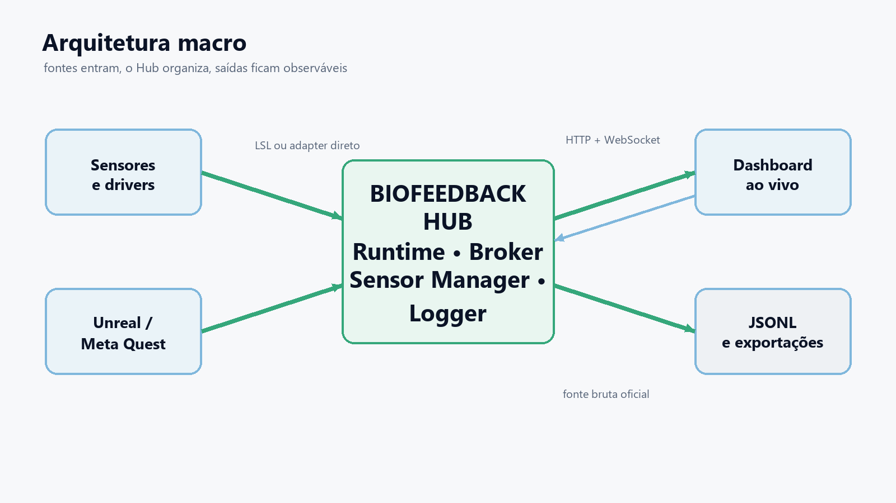
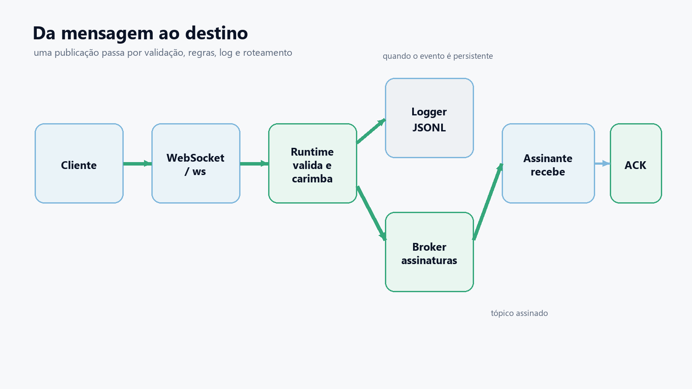
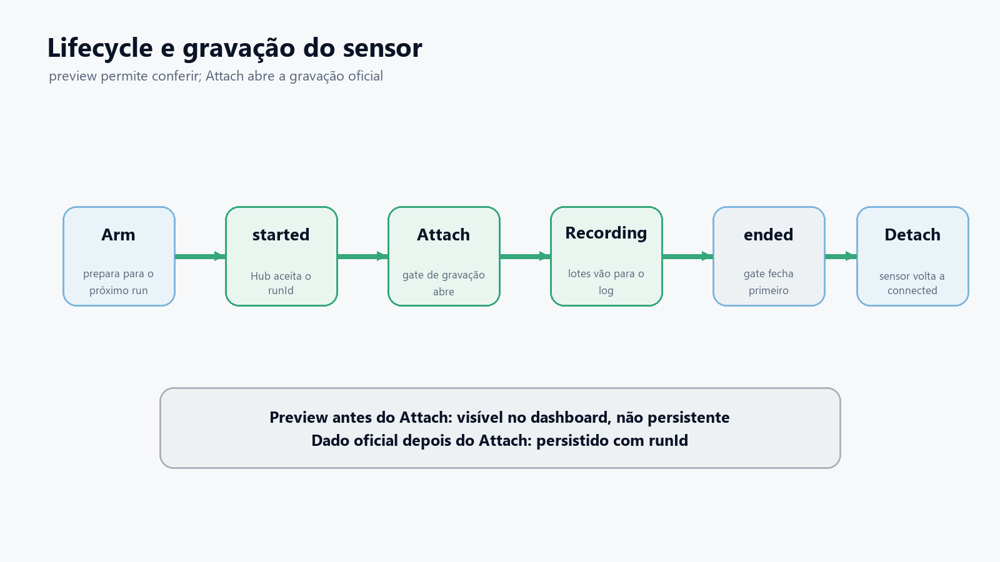
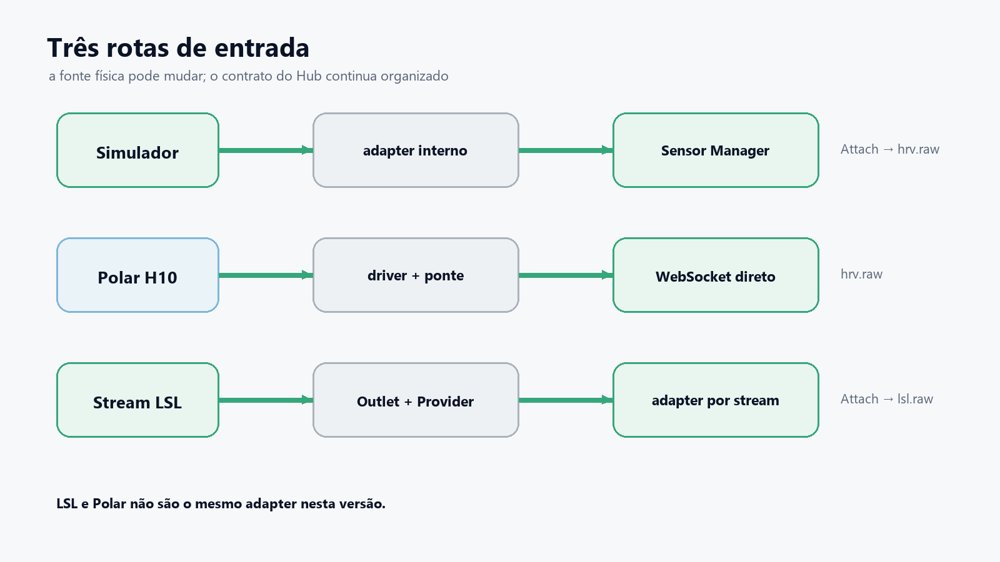
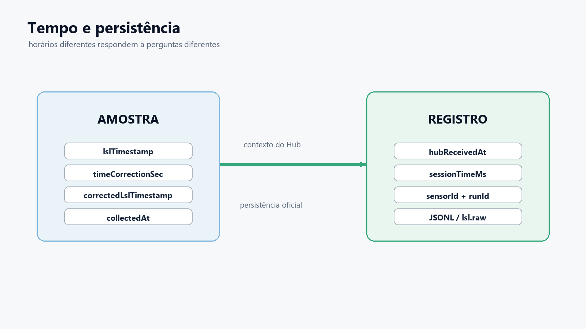

# Arquitetura do Biofeedback Hub

## Referência canônica da V0.4

**Versão documentada:** V0.4, adapter LSL mínimo
**Público:** equipe técnica, pesquisadores, orientadores e operadores sem experiência prévia em software
**Objetivo:** explicar como o Hub conecta experiências Unreal/Meta Quest, sensores, dashboard e arquivos de sessão.

> **Em termos simples:** o Biofeedback Hub é o ponto central que recebe sinais de sensores e eventos da experiência, organiza tudo durante uma sessão, mostra o estado ao operador e preserva os dados para análise posterior.



## 1. Visão em três minutos

Uma experiência de pesquisa combina duas fontes principais:

- **O mundo físico:** sensores biométricos ou de movimento, geralmente conectados por Bluetooth, USB, serial ou por um driver do fabricante.
- **A experiência virtual:** Unreal e Meta Quest, que enviam estado da aplicação, marcadores, ciclo da experiência e telemetria de execução.

O Hub recebe essas fontes em um processo local. Ele não precisa saber interpretar todos os sensores para registrar o que chega. Sua responsabilidade central é dar identidade, contexto de sessão, ordem operacional, observabilidade e persistência aos eventos.

O dashboard é a interface do operador. Ele consulta a saúde do Hub por HTTP, observa eventos por WebSocket e envia comandos de controle com confirmação. O arquivo JSONL é a fonte bruta oficial da sessão; o relatório exibido no navegador é uma visão operacional e analítica, não um substituto do log completo.

### O que pertence ao Hub

- conexão WebSocket com Unreal, dashboard e integrações diretas;
- validação do envelope das mensagens;
- roteamento por tópicos e rastreamento de ACKs;
- autoridade sobre `runId` e ciclo da experiência;
- Sensor Manager e adapters gerenciados;
- preview, Attach, Detach e gravação oficial de sensores;
- logs locais em JSONL, diagnósticos e estado operacional;
- integração opcional com LSL.

### O que não pertence ao Hub

- o driver Bluetooth, USB ou serial do fabricante;
- a lógica interna da experiência Unreal;
- a renderização do jogo ou a captura de vídeo do Quest;
- a interpretação científica automática de ECG, EEG, HRV ou IMU;
- a correção de todos os problemas físicos de rede ou de um sensor;
- a análise científica offline que exige métodos próprios do experimento.

> **Atenção:** LSL não substitui o driver físico. O caminho típico é `sensor -> driver -> LSL Outlet -> LSL Inlet do Hub`. A Polar H10 também possui uma rota direta disponível para testes: `cinta -> driver externo -> ponte WebSocket -> Hub`.

## 2. Arquitetura macro e limites

O desenho usa mais de um tipo de conexão porque cada fronteira tem uma função diferente:

- **Bluetooth, USB e serial:** ligação física entre o equipamento e seu driver ou aplicativo.
- **LSL:** middleware especializado em streams de séries temporais, descoberta, metadados e referências temporais.
- **WebSocket:** canal bidirecional usado pelo Hub, dashboard, Unreal e bridges diretas.
- **HTTP:** endpoints de saúde e estado, como `/health` e `/status`.
- **JSONL:** persistência local append-only, uma mensagem JSON por linha.

O Hub é **local-first**. A coleta não depende de um backend remoto para funcionar; a rede local é usada para conectar processos e dispositivos que estejam fora da máquina do Hub.

## 3. Núcleo do Hub

O backend fica em `apps/hub` e é organizado em camadas pequenas, cada uma com uma responsabilidade clara.

### 3.1 Entrada e aplicação FastAPI

`biofeedback_hub.main` cria a aplicação FastAPI, inicia o Sensor Manager junto com o ciclo de vida do processo e expõe:

- `GET /health`: resposta curta de saúde, incluindo falha de log e pendências;
- `GET /status`: clientes, assinaturas, ACKs pendentes, Sensor Manager, lifecycle e estado do logger;
- `WS /ws`: canal principal para mensagens de clientes.

O primeiro pacote de cada WebSocket precisa ser `hello`. A aplicação valida a estrutura do envelope e, quando configurado, o token local. `clientId`, função e capacidades identificam e descrevem o cliente; nesta versão, não existe um catálogo rígido de permissões para cada capacidade declarada.

### 3.2 Envelope e tópicos

As mensagens usam um envelope comum. O envelope traz o tipo da mensagem, cliente, tópico, identificação, correlação, horários e payload. Isso permite que o Hub transporte dados de naturezas diferentes sem criar uma conexão específica para cada sensor.

```json
{
  "version": 1,
  "id": "mensagem-123",
  "type": "publish",
  "topic": "unreal.state",
  "clientId": "unreal-quest-3s",
  "requiresAck": false,
  "payload": { "status": "streaming" }
}
```

Os tópicos atuais mais importantes são:

- `experience.lifecycle` e `experience.marker`;
- `unreal.state` e `unreal.commands`;
- `sensor.commands`, `sensor.status`, `sensor.preview` e `sensor.session`;
- `hrv.raw` para a ponte Polar e outras integrações HRV;
- `lsl.raw` para lotes brutos recebidos via LSL;
- `system.ping` e `system.pong` para probes efêmeros de comunicação.

### 3.3 Runtime e Broker

O `HubRuntime` é a camada que aplica as regras do sistema. A validação estrutural do envelope acontece na entrada FastAPI/Pydantic; depois, o Runtime acrescenta o horário de recebimento do Hub, aplica regras especiais, registra o evento quando aplicável e entrega a mensagem ao broker.

O `TopicBroker` mantém:

- clientes conectados;
- assinaturas exatas por tópico;
- outboxes limitados por cliente, com FIFO para eventos confiáveis;
- coalescência do último valor para telemetria visual do dashboard;
- destinatários esperados e ACKs pendentes.

Quando uma mensagem exige ACK, o Hub correlaciona o retorno com a mensagem original e encaminha a confirmação ao cliente que publicou o comando. O ACK confirma a resposta do destinatário; ele não substitui a verificação do estado final da sessão.

O dashboard captura o `runId` autoritativo no momento em que envia cada comando. Se
o primeiro prazo de resposta vencer, o comando aparece como `timeout`, mas a
conexão permanece aberta por uma janela curta para reconciliar um ACK tardio.
Quando esse ACK chega, ele atualiza o mesmo item pelo `messageId` e mantém a
associação com a execução de origem; respostas não correlacionadas são ignoradas.

Cada outbox tem limites explícitos. Eventos críticos preservam a ordem FIFO; em tópicos visuais como `unreal.state`, `hrv.raw` e `sensor.preview`, o dashboard pode receber somente o valor mais recente por origem quando acumula mensagens. Um consumidor que enche a fila confiável é desconectado com o motivo `slow_consumer`. Essa compactação só afeta a entrega visual; nunca altera o JSONL oficial.



### 3.4 Logger JSONL

O `JsonlSessionLogger` grava os envelopes em `data/sessions/session-<identificador>.jsonl`. A escrita é append-only e usa uma única fila limitada com um writer dedicado, para não criar uma tarefa de disco por evento nem bloquear diretamente o loop assíncrono. O encerramento do Hub aguarda a fila terminar e tenta fazer o flush mesmo quando a limpeza do Sensor Manager encontra uma falha.

Se uma escrita falhar, o erro do writer é terminal: o Hub não reinicia o writer silenciosamente, acorda produtores que esperavam espaço e expõe a falha em `/health` e `/status`. As transições de lifecycle aguardam a confirmação da gravação antes de alterar o `activeRunId` ou serem distribuídas. Telemetria de alta frequência continua usando admissão assíncrona na fila; o flush final informa se a persistência não pôde ser concluída.

## 4. Sessão e ciclo da experiência

Há duas identidades diferentes:

- **`sessionId`:** identifica o arquivo e o processo de coleta do Hub.
- **`runId`:** identifica uma experiência específica dentro daquela sessão.

Uma sessão pode conter mais de um run, mas cada run precisa ter uma janela de início e fim clara.

O `activeRunId` mantido pelo Runtime do Hub é a autoridade. Um `started` de outro run enquanto existe um run ativo recebe `lifecycle_conflict`. Um run já encerrado não pode ser reiniciado no mesmo processo. Repetições válidas do mesmo evento são tratadas de maneira idempotente.

Se a conexão cair depois de o dashboard iniciar uma experiência, a interface preserva a tentativa como incerta e consulta novamente o `/status`. Caso exista um run órfão, o operador pode confirmar **End pending run**. A recuperação encerra o run real, faz o detach necessário, preserva logs e não começa um novo run automaticamente.



## 5. Sensor Manager e adapters

O Sensor Manager é um cliente interno do broker, com `clientId = "sensor-manager"`. Ele assina `sensor.commands` e `experience.lifecycle`, mas é executado dentro do processo do Hub. Assim, a UI pode controlar sensores com o mesmo envelope usado por outros clientes. Esse identificador é uma convenção interna, não uma autenticação forte por si só; em uma instalação local sem token obrigatório, a proteção de identidade é limitada.

### 5.1 Estados

O estado de cada sensor representa operação, não uma classificação científica do sinal:

`configured -> available -> connecting -> connected -> recording`

Também são possíveis `stale`, `error` e `disconnected`. A flag `armedForNextRun` é uma seleção para a próxima experiência, não um estado de conexão. Já `unavailable` descreve o provider, por exemplo quando o LSL não está instalado, e não um sensor individual.

- **configured:** o adapter existe, mas ainda não foi verificado;
- **available:** foi encontrado no Scan;
- **connecting:** o Hub está abrindo a conexão;
- **connected:** recebe dados e pode mostrar preview;
- **recording:** o gate oficial está aberto para um `runId`;
- **stale:** não houve amostra dentro da janela esperada;
- **error:** o adapter falhou e informa o motivo;
- **disconnected:** não está conectado ao dispositivo ou stream.

### 5.2 Preview versus dado oficial

O preview existe para responder rapidamente: “o sensor está vivo?”. Ele mostra a amostra mais recente e o estado do adapter, mas não é evidência oficial da sessão.

Para adapters gerenciados, o dado oficial só começa quando o sensor está anexado a um `runId`. No Detach, o Hub fecha primeiro o gate e encerra a gravação, mas normalmente mantém o adapter conectado para que o preview continue; `Disconnect` é a operação que fecha a conexão. Gerações de conexão e gravação impedem que uma amostra iniciada antes do Attach, ou concluída depois do Detach, seja registrada no run errado.



## 6. Rotas de sensores

### Simulador gerenciado

O simulador HRV é um adapter interno usado para validar o fluxo do Sensor Manager sem hardware. Ele passa por Scan, Connect, preview, Arm, Attach, gravação e Detach como um sensor gerenciado.

### Polar H10

Na integração atual, a Polar segue uma rota externa:

```text
Polar H10 -> driver Bluetooth -> serviço do driver (:8765)
          -> biofeedback-polarh10 -> WebSocket do Hub (:8787)
          -> hrv.raw
```

Essa ponte publica `hrv.raw` diretamente. Ela não é, nesta versão, o mesmo adapter gerenciado que aparece no Sensor Manager LSL. Uma publicação normal pode ser persistida mesmo fora de um run e sem `runId`; nesse caso, ela é evidência operacional não associada a uma experiência específica, e não deve ser interpretada como gravação oficial anexada.

Por isso, a documentação não deve prometer para a Polar as mesmas garantias de Arm, Attach, Detach, `runId` e gate que existem para adapters gerenciados. A ponte reconecta o canal de telemetria e o canal de lifecycle com backoff de 1 a 10 segundos, enviando novo `hello` e nova assinatura no canal de lifecycle. Uma falha no endpoint `/control` é registrada sem encerrar a telemetria; comandos de gravação perdidos não são repetidos automaticamente. A ponte converte o timestamp do pacote para `collectedAt` quando possível, preserva `driverTimestamp` e `bridgeReceivedAt`, e usa fallback declarado quando o timestamp é inválido. Ela pode transportar ECG dentro de `hrv.raw` e deve ser tratada como integração externa disponível para testes, com essas limitações explícitas.

### Sensor direto ou ponte própria

Um sensor que não usa LSL precisa de uma integração preparada: driver, aplicativo, adapter ou ponte que consiga conectar em `/ws`, enviar `hello` e publicar envelopes JSON em um tópico identificado. O Hub não descobre automaticamente qualquer dispositivo Bluetooth, USB ou serial desconhecido.

### LSL

O LSL usa um **Outlet** para publicar um stream e um **Inlet** para recebê-lo. O `LslDiscoveryProvider` carrega `pylsl` opcionalmente e procura streams quando o operador clica em Scan. Cada stream numérico encontrado recebe um `LslManagedSensorAdapter` próprio, com `sensorId`, estado, metadados, preview e gate independentes.

Streams de texto e markers são contabilizados, mas ficam fora da operação da V0.4. A ausência de `pylsl` não impede o Hub de iniciar; o provider aparece como `unavailable` no diagnóstico.

## 7. Unreal e Meta Quest

O plugin canônico fica em `unreal/Plugins/QuestSupervisor`. Em um projeto consumidor, ele é instalado como plugin do projeto Unreal.

- **`UQuestSupervisorSettings`:** endpoint, identidade, token, heartbeat e opções de conexão;
- **`UQuestSupervisorSubsystem`:** proprietário da WebSocket, reconexão, telemetria e lifecycle;
- **`UQuestSupervisorComponent` e Blueprint Library:** acesso simples para Blueprints;
- **`AQuestSupervisorCommandBridgeActor`:** ponte pronta para pause, resume, markers e ACK.

O plugin envia `hello`, assina comandos e lifecycle, publica heartbeat em `unreal.state` e reconecta usando backoff. A experiência Unreal continua sendo responsável por sua própria lógica; o Hub apenas registra e coordena os eventos que recebe.

### Telemetria V2

O payload automático usa `telemetry.schemaVersion = 2` e informa `availability`. Assim, o dashboard diferencia uma medição real igual a zero de uma métrica que ainda não está disponível.

- `Application FPS`: janela móvel de um segundo;
- `Battery temperature`: leitura disponível no Android/Quest quando o sistema fornece o valor;
- `WebSocket RTT`: tempo do probe de aplicação entre plugin e Hub;
- `Probe loss`: perda de respostas dos últimos probes, não perda física de pacotes TCP;
- `experienceElapsedSec`: tempo desde o lifecycle `started` aceito;
- `supervisorUptimeSec`: tempo de vida do Supervisor, separado da experiência;
- CPU e GPU: `unavailable: not-implemented`;
- memória: coletada, mas sem gráfico nesta etapa.

RTT não representa latência fisiológica, render-to-photon nem sincronização temporal LSL.

## 8. Dados, tempo e persistência

### Timestamps

O Hub trabalha com horários que respondem a perguntas diferentes:

- `collectedAt`: quando o produtor informa que a amostra foi coletada;
- `hubReceivedAt`: quando o Hub recebeu e processou a mensagem; esse valor é sempre reescrito pelo Hub e não pode ser fornecido pelo cliente;
- `sessionTimeMs`: posição operacional dentro da sessão do cliente;
- `lslTimestamp`: timestamp original fornecido pelo Outlet LSL;
- `timeCorrectionSec`: estimativa de correção temporal fornecida pelo LSL;
- `correctedLslTimestamp`: timestamp LSL após a correção disponível.

Na V0.4, o Hub preserva o original e o corrigido. Ele não aplica dejitter nem força monotonicidade para criar uma precisão científica que não foi medida.



### Persistente ou efêmero

Entram no JSONL os eventos normais, lifecycle, markers, telemetria, `sensor.status`, `sensor.session`, `hrv.raw`, `lsl.raw` e ACKs recebidos. Para adapters gerenciados, o dado bruto oficial exige `Attach`; a ponte Polar externa é uma exceção de compatibilidade e pode registrar `hrv.raw` fora de um run, sem associação oficial. Não entram `sensor.preview`, `system.ping`, `system.pong`, erros efêmeros de lifecycle e amostras gerenciadas atrasadas de runs encerrados.

O dashboard mantém uma visão local para operar, pesquisar e montar relatórios, mas pode limitar a quantidade de eventos e não preserva todos os lotes brutos de alta frequência. Para auditoria ou análise científica, o JSONL do Hub deve ser preservado.

O histórico operacional exibido na aba de comandos é separado do histórico usado
para o relatório. **Clear history** remove apenas a lista operacional; os comandos
já associados ao `runId` continuam disponíveis para a execução e para o export.
Comandos posteriores ao encerramento não alteram o relatório anterior, mesmo que
um estado antigo do Hub tenha associado o comando ao mesmo `runId`.

### Vários sensores em `lsl.raw`

O tópico `lsl.raw` é compartilhado como categoria de dado bruto, mas os sinais não são misturados. Cada lote mantém `sensorId`, `runId`, identidade do stream, canais, unidades, metadados e amostras.

Essa é a decisão híbrida da V0.4:

- manter `lsl.raw` como fonte canônica, genérica e auditável;
- separar consultas e exports por `runId` e `sensorId`;
- evitar tópicos dinâmicos como `lsl.<sensorId>.raw` como contrato principal;
- no futuro, permitir mapeamento semântico aprovado para `ecg.raw`, `eeg.raw`, `imu.raw` ou outro tópico, sem apagar o bruto original.

## 9. Diagnóstico, segurança e limites

O operador pode observar o sistema por três superfícies:

- `/health`: o Hub está respondendo e o logger está saudável?
- `/status`: quem está conectado, quais tópicos existem, qual run está ativo e qual o estado dos sensores?
- **Diagnostics / biofeedback-doctor:** endpoint, dependências, provider LSL, portas, clientes e motivos de falha.

O LSL não é criptografado por padrão. A coleta deve usar uma rede local protegida. Tokens do Hub são opcionais para uso local e, quando usados pelo dashboard, ficam na configuração local do navegador; máquinas compartilhadas exigem cuidado.

Limites atuais importantes:

- estado do lifecycle e dos sensores permanece em memória e não é reconstruído automaticamente a partir do JSONL;
- o broker não oferece replay para clientes que chegaram depois;
- ACKs pendentes não têm timeout automático no broker;
- outboxes são limitados: telemetria visual pode ser coalescida e eventos confiáveis podem provocar desconexão `slow_consumer` quando o limite é atingido;
- uma falha do writer JSONL é terminal para aquela execução do logger e deixa o Hub degradado até intervenção do operador;
- o dashboard pode perder o stream de monitoramento e exigir reconexão, mesmo que o polling HTTP ainda funcione;
- LSL, Polar e adapters diretos possuem contratos diferentes e não devem ser tratados como uma única camada física.
- `sensor-manager` é uma identidade interna convencionada; sem token obrigatório, não equivale a autenticação forte.

## 10. Implementado na V0.4 e evolução

### Implementado na V0.4

- Hub local com FastAPI, HTTP e WebSocket;
- envelope versionado, tópicos, publish/subscribe e ACK;
- lifecycle autoritativo, conflito e recuperação de run órfão;
- logger JSONL append-only e endpoints de diagnóstico;
- Sensor Manager interno com simulador, estados, preview, Arm, Attach e Detach;
- provider LSL opcional, Scan de streams numéricos e um adapter por stream;
- metadados LSL, lotes `lsl.raw` e timestamps original/corrigido;
- integração direta Polar H10 por ponte WebSocket;
- plugin Unreal com reconexão, lifecycle, comandos, markers e telemetria V2;
- dashboard com Controle da sessão, Sensores, gráficos de telemetria, relatório e exportações locais;
- endurecimento de persistência, recuperação de Sensor Manager, reconexão da ponte Polar e isolamento do histórico por execução.

### Evidência e estado de fechamento

Os testes automatizados e a validação física não são a mesma evidência. O conjunto automatizado cobre o comportamento do Hub, do dashboard, do adapter LSL e das pontes simuladas. O teste físico de 27/08 preserva os resultados observados, mas registra separadamente uma interrupção do driver e um evento de suspensão do Quest; por isso, não deve ser descrito como cinco minutos contínuos de execução conjunta sem evidência. A síntese de resultados e os critérios de interpretação ficam em [Validação final da V0.4](validation/v0-4-final-validation.md).

### Evolução recomendada

Como evolução recomendada, ficam: **perfis locais** de experimento com sensores e preferências pré-configurados; **mapeamentos semânticos** aprovados para sinais conhecidos; **exports particionados por sensor** mantendo o `lsl.raw` original; **LabRecorder/XDF e markers LSL** quando houver requisito científico formal; **gráficos específicos por canal e unidade**; suporte próprio a **markers e streams textuais LSL**; **persistência multi-run indexada**, replay controlado, melhorias de retenção, reconexão do dashboard e políticas de timeout de ACK.

## Glossário rápido

**Adapter e Provider:** o primeiro traduz uma fonte para o contrato do Hub; o segundo descobre e disponibiliza adapters. **Broker e Tópico:** o broker roteia mensagens aos clientes inscritos; o tópico nomeia a categoria publicada e recebida (`publish/subscribe`). **ACK e gate:** ACK é a confirmação correlacionada de um comando; gate é a trava da gravação oficial. **Arm, Attach, Detach e Lifecycle:** selecionar um sensor, anexá-lo ao run, encerrar sua gravação e marcar o ciclo da experiência. **Endpoint, Inlet e Outlet:** endereço de serviço, receptor LSL e publicador LSL. **Preview, RTT e Backoff:** amostra recente sem valor oficial, tempo de ida e volta e espera crescente entre reconexões. **JSONL, Run e Stream:** arquivo de objetos JSON por linha, experiência identificada por `runId` e fluxo de amostras com canais/metadados.
